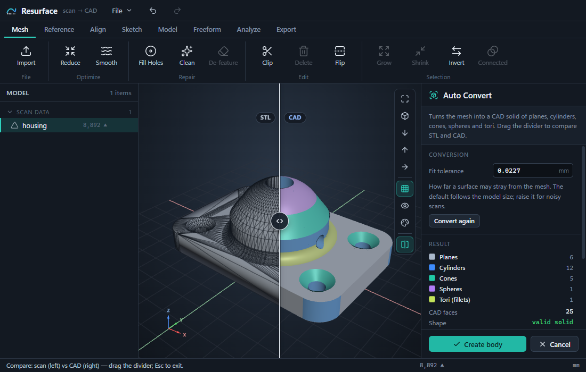
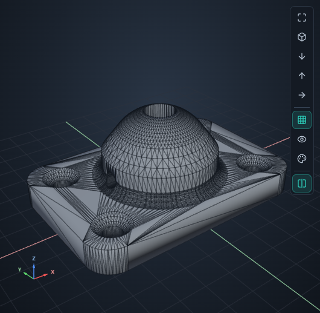
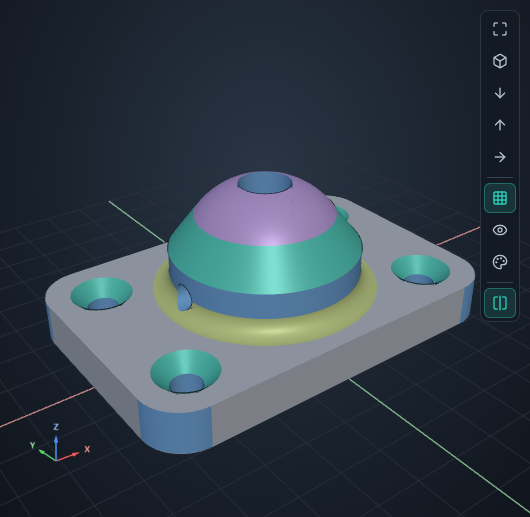
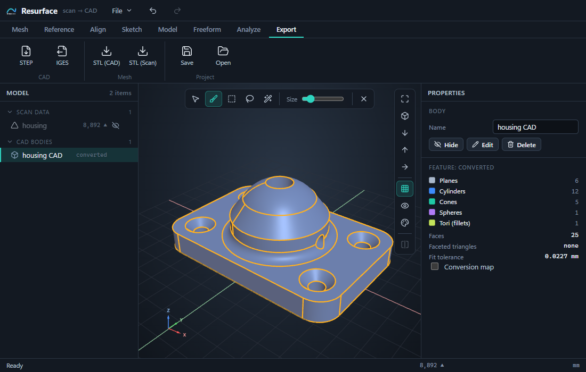
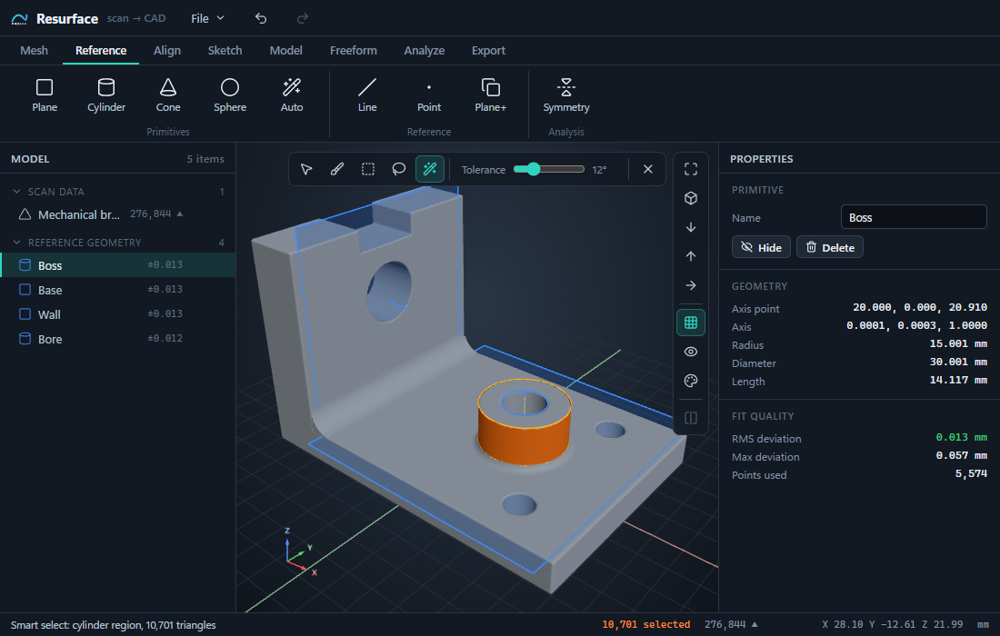
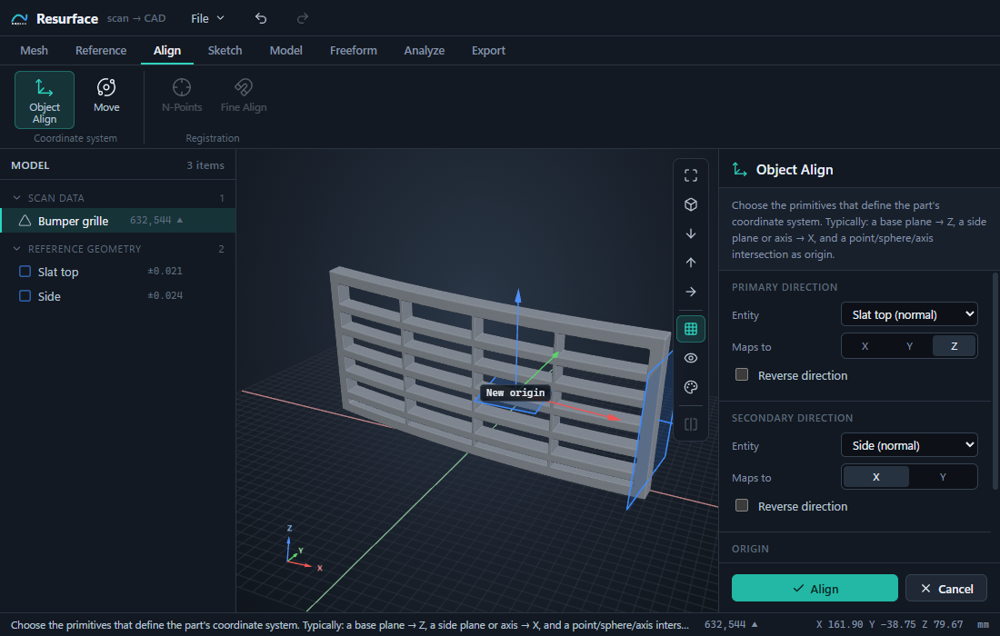
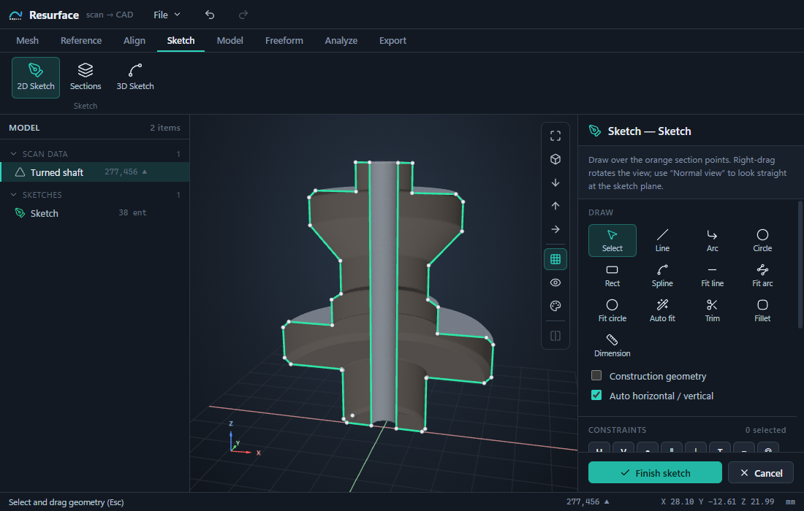
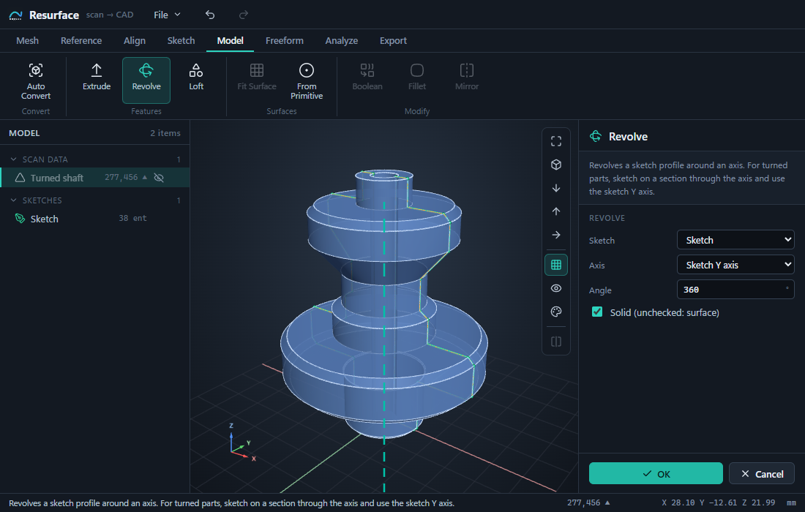
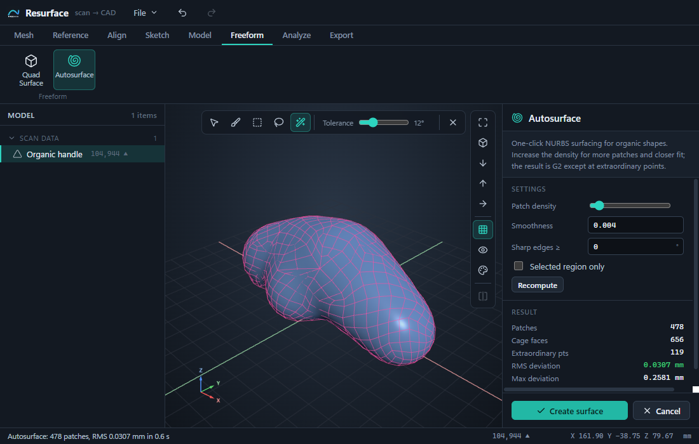
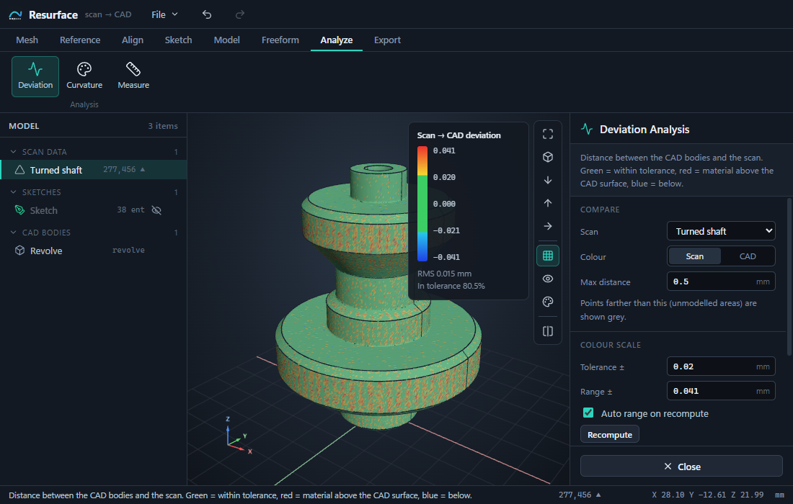

<h1 align="center">Resurface</h1>

<p align="center">
  <b>Scan-to-CAD reverse engineering.</b><br>
  Turn STL files and 3D scans into editable CAD solids and export STEP / IGES.
</p>

<p align="center">
  <a href="https://github.com/clucraft/resurface/releases/latest"><b>Download for Windows</b></a> ·
  <a href="#auto-convert-stl-to-step-in-one-click">Auto Convert</a> ·
  <a href="#reverse-engineering-a-3d-scan">Scan workflow</a> ·
  <a href="#all-features">All features</a> ·
  <a href="#development">Development</a>
</p>



Resurface runs as a Windows desktop app (Electron) and in any modern Chromium browser. The
geometry kernel is Open CASCADE 8 compiled to WebAssembly; rendering uses three.js. Everything runs
locally, and nothing is uploaded.

> Status: 0.1, with the core workflow complete. Under active development.

## Auto Convert: STL to STEP in one click

Do you have an STL of a part whose CAD file is lost? It might be a Thingiverse download, an old
export or a supplier's part. Import it and click **Model → Auto Convert**. Resurface rebuilds it
as a real CAD solid, ready for Fusion, SolidWorks, FreeCAD, Onshape or any CAM package.

- **Real faces, not a triangle soup in a STEP file.** Planes, cylinders, cones, spheres and tori
  (fillets) are recognised and built as exact analytic faces, with true edges where they meet.
- **Always a closed solid.** Areas that match no surface type stay as faceted faces, so the solid
  still closes. The result panel reports the recognised area, the faceted triangles left, the
  largest deviation from the STL and the volume.
- **See what you got.** The *conversion map* colours every face by type: grey planes, blue
  cylinders, teal cones, purple spheres, yellow tori and red facets. The *Compare* divider slides
  between the original STL and the CAD result from the same camera.
- **Keep going or export.** *Create body* adds the solid to the model. Export it as **STEP** or
  IGES, or keep modelling on it in Resurface with fillets, booleans or mirror.
- **Fast and local.** Typical parts convert in seconds and detailed ones in under a minute. The
  fit tolerance follows the model size; raise it for noisy scans.

| The STL as imported: 8,892 triangles | After Auto Convert: 25 exact faces, a valid solid |
| --- | --- |
|  |  |

The housing above was modelled with 6 planes, 12 cylinders, 5 cones, 1 sphere and 1 torus. Auto
Convert recovers exactly those 25 faces from the STL in about half a second.



**Try it:** *File → Samples → Mounting plate (CAD STL)*, then *Model → Auto Convert*.

Auto Convert works best on STLs that came from CAD, such as machined, turned and printed parts.
Organic shapes like handles, figures and body panels have no planes or cylinders to find. Use
*Freeform → Autosurface* for those.

## Reverse engineering a 3D scan

For real scans, Resurface has a complete reverse-engineering toolset: fit primitives, align the
scan, sketch on sections, build parametric features, surface organic shapes and check the result
against the scan.

<table>
  <tr>
    <td width="50%" valign="top">
      <br>
      <b>Smart select and fit primitives.</b> One click selects a whole plane, cylinder, cone or
      sphere face and stops at fillets. Fit it as reference geometry, with RMS and max deviation shown.
    </td>
    <td width="50%" valign="top">
      <br>
      <b>Align.</b> Straighten a tilted scan onto the world axes from fitted primitives. N-point
      registration and ICP fine alignment line up two scans.
    </td>
  </tr>
  <tr>
    <td width="50%" valign="top">
      <br>
      <b>Sketch on sections.</b> Cut the scan with a plane and <i>Auto fit</i> the section into
      tangent lines and arcs. Add constraints and driving dimensions with a live solver.
    </td>
    <td width="50%" valign="top">
      <br>
      <b>Parametric features.</b> Extrude, revolve, loft, booleans, fillet, chamfer and mirror.
      Edit a sketch or a dimension and the dependent bodies rebuild.
    </td>
  </tr>
  <tr>
    <td width="50%" valign="top">
      <br>
      <b>Freeform surfacing.</b> <i>Autosurface</i> lays out a watertight NURBS patch network on
      organic shapes in one click. <i>Fit Surface</i> and <i>Quad Surface</i> give manual control.
    </td>
    <td width="50%" valign="top">
      <br>
      <b>Deviation analysis.</b> A colour map of the scan against the CAD model, with a tolerance
      band, RMS and the share of points in tolerance.
    </td>
  </tr>
</table>

### Typical workflow

**STL from CAD** (for example a Thingiverse part whose source file is lost):

1. Import the STL.
2. Click *Model → Auto Convert*.
3. Check the conversion map and the Compare divider.
4. Click *Create body*.
5. Export with *Export → STEP*.

**3D scan:**

1. **Import** a scan and clean it up on the *Mesh* tab: Clean, Fill Holes, Reduce.
2. **Smart-select** faces (key `5`) and fit planes or cylinders on the *Reference* tab.
3. **Align** the scan to the world axes with *Align → Object Align*: base plane → Z, side plane → X.
4. **Sketch** on a section (*Sketch → 2D Sketch*). Click section curves with **Auto fit**, add
   constraints and dimensions, then **Extrude** or **Revolve** on the *Model* tab.
5. For organic areas use **Fit Surface**, **Quad Surface** or **Autosurface** on the *Freeform* tab.
6. Check **Deviation** on the *Analyze* tab and **Export** STEP or IGES.

Built-in samples (*File → Samples*):

- a mechanical bracket;
- a turned shaft;
- an organic handle;
- a bumper grille;
- a mounting plate STL exported from CAD, for trying Auto Convert.

## All features

| Area | What you can do |
| --- | --- |
| **Auto Convert (STL → CAD)** | One click (*Model → Auto Convert*) rebuilds an STL exported from CAD as a solid of real faces: planes, cylinders, cones, spheres and tori (fillets), with exact edges between them, ready for STEP. Areas it cannot recognise stay as faceted faces, so the result is always a closed solid. The conversion map colours faces by type, and the **Compare** split view shows STL and CAD side by side. |
| **Import** | STL (ASCII/binary, streamed), OBJ, PLY (ASCII/binary, colours, point clouds) and PTX gridded scans. Drag and drop, or use *Mesh → Import*. Scans up to ~20M triangles stay interactive (LOD while orbiting, background spatial indexing). |
| **Mesh** | Reduce (quadric decimation, plus clustering for huge scans). Taubin smoothing (whole mesh or a selection). Fill holes with curvature-matched patches. Clean small shells and degenerates. Clip with a plane, delete, flip. **De-feature**: remove stamps and markers and fill smoothly. |
| **Selection** | Brush, rectangle and lasso (visible triangles only). **Smart select**: primitive-aware region growing that selects a whole plane, cylinder, cone or sphere face and stops at fillet boundaries. Grow, shrink, invert, connected. |
| **Reference geometry** | Fit a plane, cylinder, cone or sphere to the selection, or *auto-detect* the type (robust least squares + RANSAC). Reference lines: axes, plane intersections, 2 points. Points: picked, centres, 3-plane intersections. Constructed planes: offset, mid-plane, 3 points, through an axis, and more. **Symmetry plane** finder with a mirror-deviation colour map and fine-tuning. |
| **Alignment** | **Object Align** to the world coordinate system from primitives, numeric move and rotate, **N-point** registration of two scans, **fine align** (point-to-plane ICP). |
| **2D sketching** | Interactive sections: world or reference planes, perpendicular to or through an axis, parallel stacks. Sketch over the section points with lines, 3-point arcs, circles, rectangles and splines. **Fit line/arc/circle** to section points, or **auto-fit** whole section curves into tangent lines and arcs. Geometric constraints (H, V, coincident, parallel, perpendicular, tangent, equal, concentric, collinear, midpoint, fix) and driving dimensions, solved in real time. Trim and fillet. |
| **3D sketching** | Draw smooth curves directly on the scan (a spline snapped to the surface). |
| **CAD features** | Extrude (one side, symmetric or two sides, with draft), revolve, loft through sections, surfaces from primitives, booleans (unite, subtract, intersect), fillet and chamfer with edge picking, mirror. All features stay parametric: edit a sketch or dimension and dependent bodies rebuild. |
| **Surfacing** | **Fit Surface**: a NURBS surface fitted to a selected region, with a live deviation map. **Quad Surface**: build a quad cage on the scan, or generate it from a selection; the Catmull–Clark limit surface snaps to the scan. **Autosurface**: one-click NURBS patch layout for organic shapes. It is G2 everywhere except G1 at extraordinary points, and gives a watertight solid when the shape is closed. |
| **Analysis** | Real-time **deviation** colour map (scan → CAD or CAD → scan) with a tolerance band and statistics. Curvature map. Measurements: points, planes, axes, angles. **Compare** split view (viewport toolbar): the scan with its triangle edges on the left of a draggable divider, the CAD model on the right, from the same camera. |
| **Export** | STEP (AP214, named bodies), IGES 5.3 (trimmed NURBS surfaces), and STL of CAD bodies or of the scan. Projects save as `.rsf`. |

### Navigation

| Input | Action |
| --- | --- |
| Right drag | Rotate around the point under the cursor |
| Middle drag (or Shift + right drag) | Pan |
| Wheel | Zoom at the cursor |
| `F` | Fit all |
| `1`–`5` | Pick / Brush / Rectangle / Lasso / Smart select |
| Shift / Ctrl + click | Add to / remove from the selection |
| `[` `]` | Brush size |
| `Esc` | Cancel the tool / leave the compare view / clear the selection |
| Ctrl+Z / Ctrl+Y | Undo / redo |

In the sketch editor: `L` line, `A` arc, `C` circle, `R` rectangle, `S` spline, `D` dimension,
`T` trim, `N` normal view, `Del` delete.

## Installing (Windows)

1. Download `Resurface-Setup-<version>.exe` from
   [Releases](https://github.com/clucraft/resurface/releases/latest).
2. Run it. It installs for the current user and needs no admin rights.

The installer isn't code-signed yet, so Windows SmartScreen may warn about it. Choose **More info →
Run anyway**.

You can open scan files (`.stl .obj .ply .ptx`) and projects (`.rsf`) with Resurface from
Explorer. To build the installer yourself, see [Development](#development).

## Development

Requires Node.js 22+ (developed on Node 24).

```bash
npm install
npm run dev          # browser dev server with hot reload → http://localhost:5173
npm run dev:stable   # no hot reload (stable session while files change) → http://localhost:5174
npm test             # unit tests (vitest, ~370 tests)
npm run typecheck
npm run desktop      # build and run the Electron desktop app
npm run dist:win     # build the Windows installer into release/
```

`RESURFACE_SMOKE=<dir> npx electron .` runs an automated smoke test of the desktop build. It loads
a sample, exercises the CAD kernel, and writes a screenshot and a JSON report.

The README screenshots are generated by a scripted tour. With `npm run dev:stable` running, run
this (in Git Bash or another POSIX shell):

```bash
RESURFACE_DEV_URL=http://localhost:5174 RESURFACE_TOUR_SIZE=1100x700 RESURFACE_TOUR_DIR=docs/screenshots RESURFACE_TOUR_SCRIPT=scripts/readme-tour.js npx electron .
```

See [docs/ARCHITECTURE.md](docs/ARCHITECTURE.md) for the module layout.

## Licences

Resurface's own code is private. Third-party components:

- Open CASCADE Technology (LGPL-2.1, via `replicad-opencascadejs`);
- three.js and three-mesh-bvh (MIT);
- React (MIT);
- lucide icons (ISC);
- Electron (MIT).
